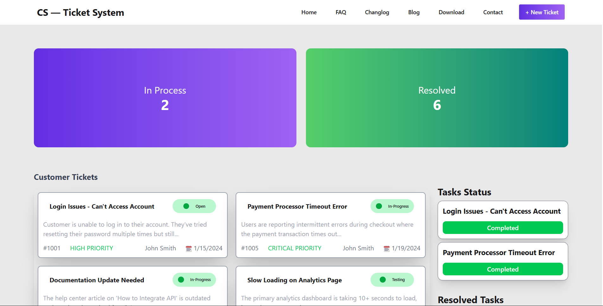
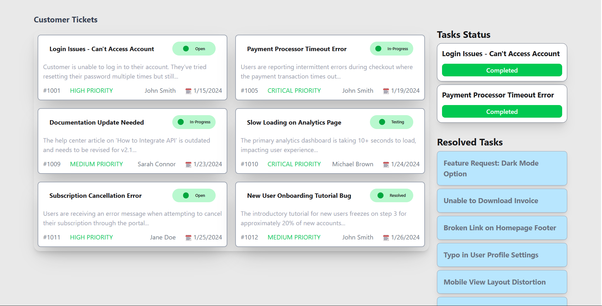
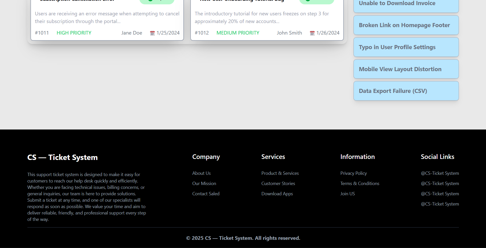

# 🧩 Customer Support Zone

A React-based **Customer Support Zone** web app designed to display customer tickets, manage their progress, and mark them as resolved — all following a clean and responsive Figma design.  
It includes interactive status tracking, responsive layouts, and toast notifications using **React-Toastify**.

---

## 🚀 Live Demo  
🔗 [Click here to see the  Live Project](https://a07-customer-support-zone.pages.dev/)
---

## 📸 Preview  




---


## 🧰 Tech Stack

| Category | Tools Used |
|-----------|-------------|
| **Frontend Framework** | React.js |
| **Styling** | CSS / Tailwind (depending on your setup) |
| **Data Handling** | Local JSON data / useState |
| **Deployment** | Vercel / Netlify  |
---
## 📌 Features & Requirements

### ✅ Navbar
- Displays website name or logo on the **left**.  
- Menu items and a **New Ticket** button on the **right**.

### ✅ Banner
- Built according to **Figma design**.  
- Features a **linear gradient background**.  
- Displays ticket statistics:
  - **In Progress Count**
  - **Resolved Count** (default = 0)

### ✅ Main Section

#### 🎟 JSON Ticket Data
Created **10–15 sample tickets** containing:
```js
 {
        "id": "#1001",
        "title": "Login Issues - Can't Access Account",
        "description": "Customer is unable to log in to their account. They've tried resetting their password multiple times but still...",
        "priority": "HIGH PRIORITY",
        "status": "Open",
        "assignee": "John Smith",
        "date": "1/15/2024"
    },
```
### 🗂 Ticket Cards
- Displays all ticket information inside **cards**.  
- Cards are arranged in a **2-column grid** layout (on larger screens).

---

### ✅ Footer
- Styled according to the **Figma design**.  
- Simple, clean, and **responsive**.

---

### 💻 Responsiveness
- The entire website layout is **responsive** across **mobile and desktop** screens.


---

### ⚙️ Installation & Setup

```bash
# 1️⃣ Clone this repository
git clone https://github.com/yourusername/customer-support-zone.git

# 2️⃣ Navigate to project folder
cd customer-support-zone

# 3️⃣ Install dependencies
npm install

# 4️⃣ Start the development server
npm run dev
```
### 🧠 Key Learnings
- Building reusable React components.  
- Managing component states using `useState`.  
- Implementing banner counters dynamically.  
- Creating a fully responsive layout with CSS/Tailwind.

---

### ✨ Future Improvements
- Add search and filter by ticket priority or status.  
- Implement `localStorage` persistence for ticket data.  
- Add a form to create new tickets dynamically.  
- Integrate a backend (Node/Express) and database (MongoDB).

---

#### 🧑‍💻 Author
**Sayeduzzaman**  
📧 sayeduzzamansajid9@gmail.com  

